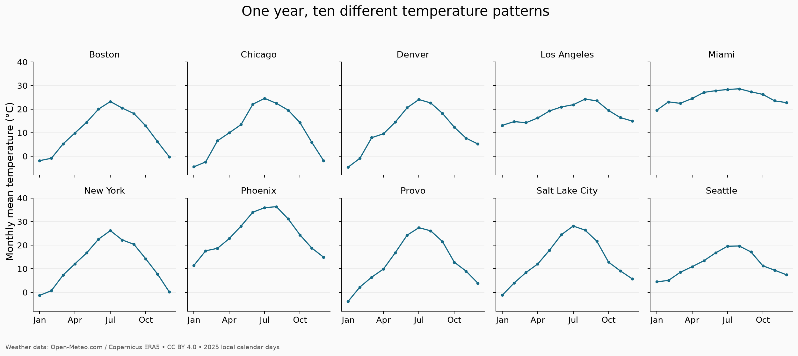
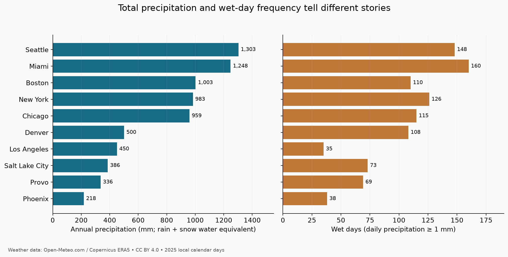
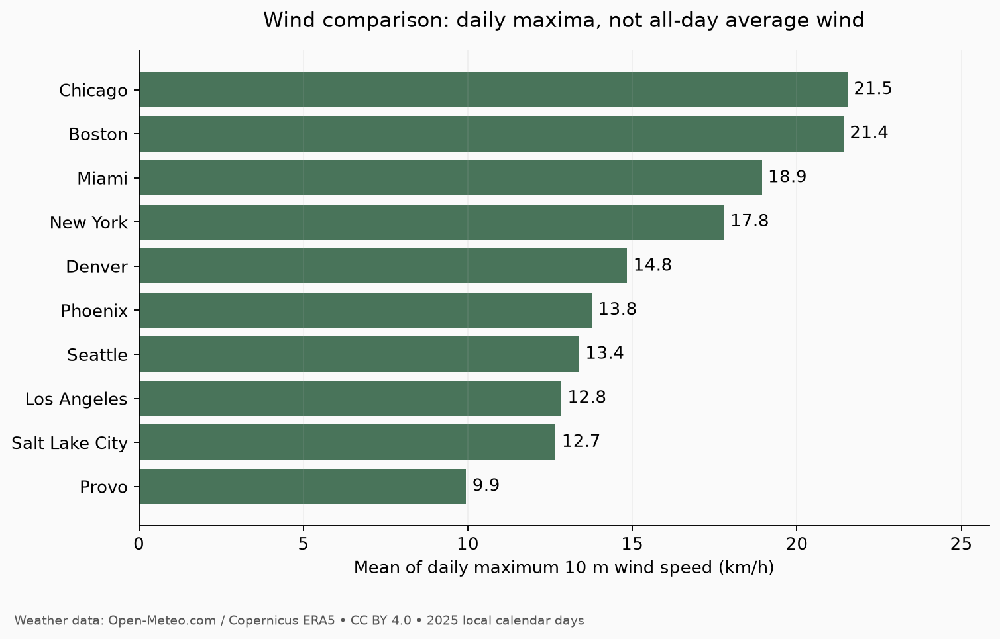

# Ten cities, one year: U.S. weather in 2025

A STAT 386 data acquisition project using Python, Open-Meteo's Geocoding API, and its Historical Weather API. **Question: How did temperature, precipitation, and wind patterns differ across ten U.S. cities in 2025?**

[Read the blog](https://kens-04.github.io/data-acquisition-weather-2025.html).

## Dataset and scope

The curated dataset has **3,650 rows × 15 columns**, with one local calendar day per city from January 1 through December 31, 2025. Cities follow the original proposal: Provo, Salt Lake City, Seattle, Los Angeles, Phoenix, Denver, Chicago, New York, Miami, and Boston. This is a purposive sample, not a representative sample of the United States.

This is an original API-based curation: city/state-validated geocoding results are combined with daily weather responses, units are standardized, and month, season, daily temperature range, and wet-day indicators are derived in Python. The fixed `era5` model avoids changing the default model mixture. These are gridded reanalysis estimates, not direct observations from a station at each city center.

## Reproduce

Tested with Python 3.13.1. From this repository's root:

```bash
python3 -m venv .venv
source .venv/bin/activate
python -m pip install -r requirements.txt
python scripts/collect.py --offline
python scripts/analyze.py
```

The offline command regenerates the curated CSV from the committed raw JSON without any network calls. The analysis regenerates all summary CSVs and three PNG figures. To collect from the API in a **fresh checkout without the raw cache**, run `python scripts/collect.py` and then `python scripts/analyze.py`. Existing cache files are intentionally reused. For a fresh snapshot, move `data/raw` to a backup location first; API revisions can change results. No API key is required. Never add credentials to this repository.

Collection uses a 90-second timeout, bounded retry/backoff for rate limits and transient server failures, and a one-second pause after successful requests. A fresh run makes 20 successful requests: ten location queries and ten annual weather queries. Provider quota accounting may count long date ranges as multiple calls. Raw responses have companion metadata recording request URLs, UTC retrieval timestamps, and SHA-256 hashes. Query parameters explicitly fix dates, model, units, and city-local time zones.

## Repository contents

- `scripts/collect.py`: collection, location disambiguation, deterministic transformation, and validation.
- `scripts/analyze.py`: city/month/season summaries and figures.
- `data/raw/`: unmodified API response bodies and retrieval metadata.
- `data/processed/weather_2025.csv`: main dataset.
- `data/processed/cities.csv`: selected GeoNames IDs, requested coordinates, returned grid coordinates, and grid elevation.
- `data/processed/validation.json`: row counts, missingness, uniqueness, and validation status.
- `data/processed/*summary.csv`: annual, monthly, seasonal, and numerical descriptive summaries.
- `figures/`: temperature, precipitation, and wind plots.
- `requirements.txt`: exact tested dependency versions.
- `DATA_LICENSE.md`: source attribution and redistribution information.

## Data dictionary

| Column | Meaning | Unit/type |
|---|---|---|
| city | Selected city | categorical |
| state | U.S. state, checked against geocoding | categorical |
| date | Local calendar date | YYYY-MM-DD |
| temp_max_c | Daily maximum air temperature at 2 m | °C |
| temp_min_c | Daily minimum air temperature at 2 m | °C |
| temp_mean_c | Daily mean air temperature at 2 m | °C |
| precipitation_mm | Daily total precipitation, including snow water equivalent | mm |
| wind_max_kmh | Daily maximum wind speed at 10 m; not a gust or daily mean | km/h |
| latitude | Requested city latitude | decimal degrees north |
| longitude | Requested city longitude | decimal degrees east |
| timezone | IANA zone used for daily aggregation | text |
| month | Month extracted from date | integer 1–12 |
| season | Winter=Dec/Jan/Feb; Spring=Mar–May; Summer=Jun–Aug; Fall=Sep–Nov | categorical |
| diurnal_range_c | Daily maximum minus daily minimum temperature | °C |
| wet_day | 1 if daily precipitation is at least 1 mm; otherwise 0 | binary integer |

Winter here combines January–February and December **within 2025**, not one consecutive winter. Annual temperature and wind summaries average the 365 daily values; seasonal means weight days equally. `summer_minus_winter_c` is the summer mean temperature minus the winter mean. `mm_per_wet_day` averages precipitation only over days meeting the 1 mm threshold, excluding trace/light precipitation below it. Annual totals include every day. Summary files round to three decimal places; analysis starts from unrounded source values.

## Quality checks and selected findings

The saved snapshot passes checks for 3,650 unique city-date pairs, all 365 expected dates per city, zero missing cells, correct API units, nonnegative precipitation and wind, and minimum ≤ mean ≤ maximum temperature. No rows were dropped, imputed, or manually edited. Logical checks detect structural problems but do not establish measurement accuracy.

| City | Annual mean temperature (°C) | Precipitation (mm) | Wet days | Mean daily maximum wind (km/h) |
|---|---:|---:|---:|---:|
| Boston | 10.70 | 1002.7 | 110 | 21.42 |
| Chicago | 10.90 | 959.2 | 115 | 21.54 |
| Denver | 11.51 | 500.3 | 108 | 14.84 |
| Los Angeles | 18.27 | 450.5 | 35 | 12.84 |
| Miami | 25.13 | 1248.1 | 160 | 18.93 |
| New York | 12.51 | 983.4 | 126 | 17.79 |
| Phoenix | 24.56 | 217.6 | 38 | 13.77 |
| Provo | 13.13 | 336.0 | 69 | 9.95 |
| Salt Lake City | 14.21 | 386.1 | 73 | 12.67 |
| Seattle | 12.02 | 1303.3 | 148 | 13.38 |

[Weather data by Open-Meteo](https://open-meteo.com/), using Copernicus ERA5; transformed and summarized for this project under [CC BY 4.0](https://creativecommons.org/licenses/by/4.0/).



[Weather data by Open-Meteo](https://open-meteo.com/). Monthly averages calculated from daily mean temperatures.



[Weather data by Open-Meteo](https://open-meteo.com/). Wet-day threshold: 1 mm.



[Weather data by Open-Meteo](https://open-meteo.com/). Mean of daily maximum 10 m wind speed.

## Responsible use and limitations

Source terms checked November 6, 2026: [API terms](https://open-meteo.com/en/terms), [data licence](https://open-meteo.com/en/licence), [historical API documentation](https://open-meteo.com/en/docs/historical-weather-api), and [geocoding documentation](https://open-meteo.com/en/docs/geocoding-api). The free endpoint permits noncommercial educational use subject to rate limits, and API data are redistributable under CC BY 4.0 with attribution, licence links, and changes identified. Geocoding uses GeoNames. This project requests public city-level environmental data and no personal information. No website scraping or authenticated access is needed.

The selected city coordinate represents one model grid location, not a citywide average. Mountain terrain, coastlines, and local storms can be smoothed by the model. Wind comparisons depend on modeled exposure and terrain. One year's estimates cannot establish long-term climate, trends, or causal explanations. Nearby cities are not independent, and consecutive days are correlated. These descriptive summaries do not use significance tests or extrapolate to all U.S. cities.
